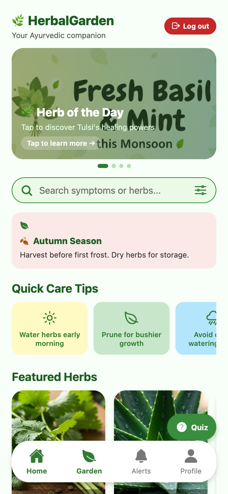
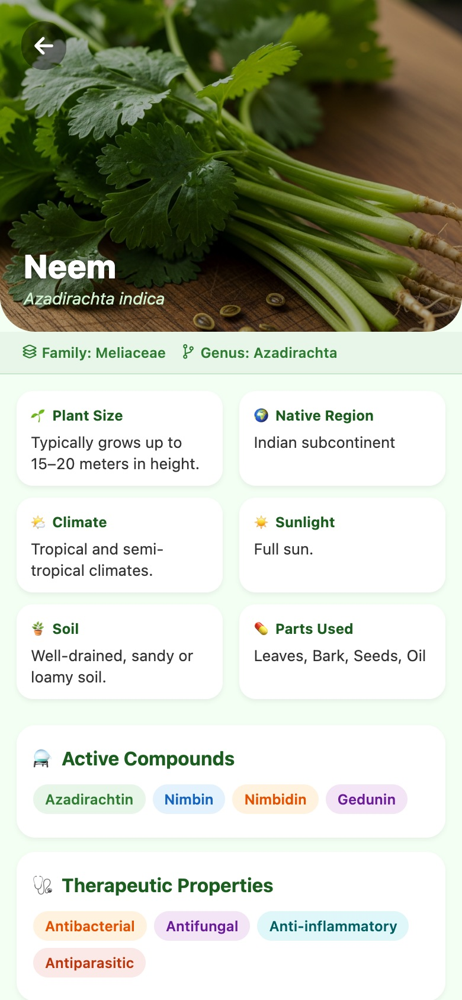
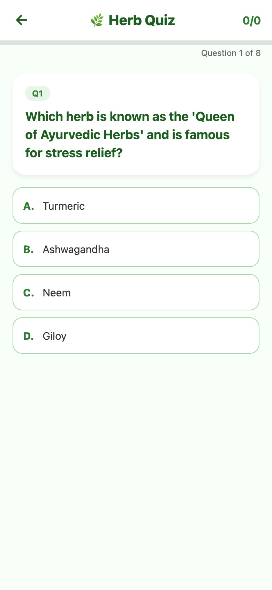

# Herbal Garden

A mobile app for discovering Ayurvedic herbs, tracking the ones you grow and testing your knowledge with a quiz. Built with React Native and Expo, and it runs on Android, iOS and the web.

**[Live demo](https://viratgupta13.github.io/herbal-garden/)** · **[Open the app directly](https://viratgupta13.github.io/herbal-garden/app/)**

<p>
  
  
  
  
</p>

## Features

- **Search and filters** to find herbs by name or by symptom
- **Herb detail pages** with scientific name, family, climate, soil, sunlight, active compounds, therapeutic properties and dosage forms
- **My Garden** to add the herbs you grow, see today's care tasks and follow growth stages
- **Seasonal tips and alerts** on the home screen
- **Ayurvedic quiz** with eight questions and a running score
- **Accounts and profile** with sign up, log in, profile editing and a tutorial. Data is stored on the device with AsyncStorage.

## Tech stack

React Native 0.81 · Expo SDK 54 · React 19 · React Navigation 7 · AsyncStorage · Reanimated · React Native Web · EAS Build

## Run it locally

```bash
npm install
npx expo start
```

Then press `a` for Android, `i` for iOS, or `w` for the browser. You can also scan the QR code with Expo Go.

## Project structure

```
App.js          navigation and the initial route (welcome or home)
screens/        one file per screen
data/herbs.json the herb database (15 herbs)
assets/         images and icons
docs/           landing page and the exported web build (served by GitHub Pages)
```

## Rebuild the web demo

```bash
npx expo export -p web --output-dir docs/app
```

## Notes

Authentication is local to the device and there is no backend. Moving accounts and the garden data to a cloud service is the natural next step.
